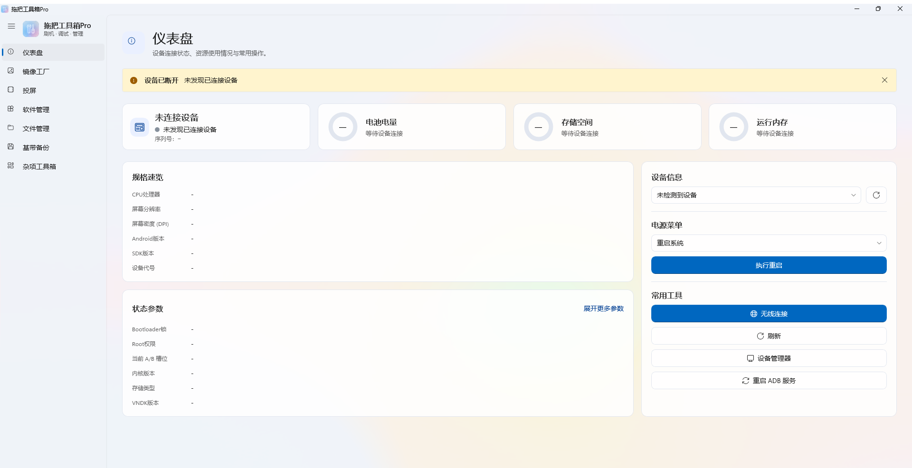
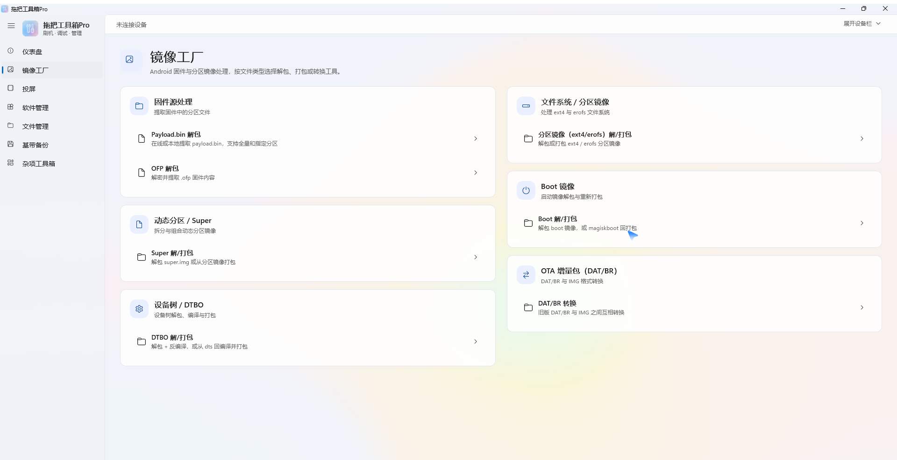
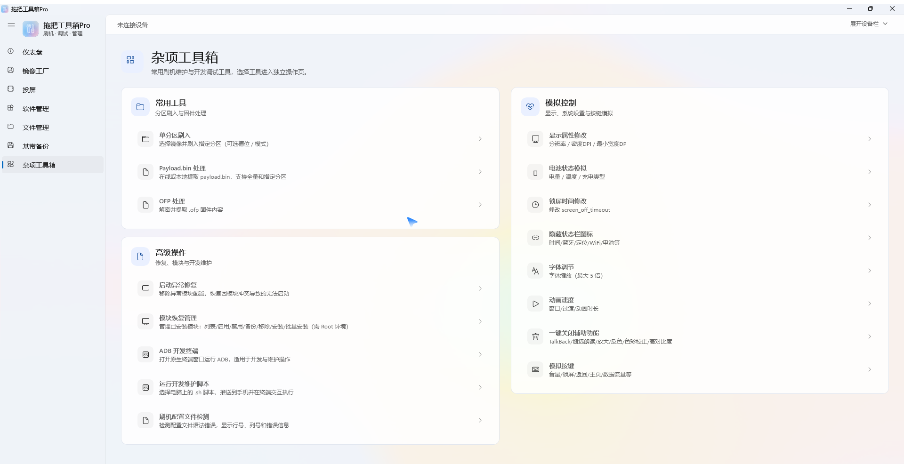

# 拖把工具箱 Pro · Tobatools Pro

> 只要一台 Android 设备解锁了 Bootloader，
> 它就不该再被任何厂商工具、任何机型白名单拦住。

基于 **C# + WinUI 3** 的原生 Windows 桌面工具集：固件处理、投屏、应用与文件管理、分区备份，以及一批按需进入的维护工具。

<p align="left">
  <a href="LICENSE"></a>
  
  
  
  
</p>

<p align="left">
  <a href="https://tobatools.top"></a>
  <a href="https://t.me/tuoba1213141647"></a>
  <a href="https://qm.qq.com/q/iBPCO3Xrjy"></a>
</p>

---

## 界面预览

| 仪表盘 | 镜像工厂 | 杂项工具箱 |
| :---: | :---: | :---: |
|  |  |  |

---

## 能力一览

| 模块 | 做什么 |
| --- | --- |
| **仪表盘** | 设备连接状态、电池 / 存储 / 内存环形读数、硬件参数与系统信息、快捷操作 |
| **镜像工厂** | `payload.bin`、`.ofp`、`super.img`、`dtbo.img`、ext4 / erofs、`boot`、OTA DAT/BR 解打包 |
| **投屏中心** | 内置 scrcpy，可调分辨率 / 帧率 / 码率 / 缓冲与窗口行为 |
| **软件管理** | 浏览应用、安装 / 导出 APK、卸载与组件管理 |
| **文件管理** | 设备存储浏览，电脑与设备双向传输 |
| **基带备份** | 分区备份，可选打包 ZIP 与恢复脚本 |
| **杂项工具箱** | 维护与开发调试工具，独立二级页面 |
| **设置** | 主题、液态玻璃外观、三语界面、下载目录与社区入口 |

完整功能说明、刷机指南与开发文档见 [`Tobatools/README.md`](Tobatools/README.md)。

---

## 快速开始

- **普通用户**：下载官方发行包，解压后运行 `TobatoolsLauncher.exe`（引导器自动检查并补齐 .NET 10 桌面运行时与 Windows App Runtime 1.8）。
- **开发者**：环境要求 .NET SDK 10、Windows 10 1809+。

```powershell
cd Tobatools
dotnet build Tobatools.csproj -c Debug -p:Platform=x64
```

## 目录结构

```
Tobatools/    # 主工程（WinUI 3），完整文档见 Tobatools/README.md
Launcher/      # .NET Framework 4.8 依赖引导启动器
docs/          # 截图等仓库资料
```

---

## 关于刷机模块

刷机中心的实现（分区刷写顺序、机型判定表、固件解包密钥、远程控制检测规则）**不随公开仓库发布**。克隆公开仓库自行构建时，对应导航项会被条件编译自动移除，构建不会报错，其余镜像处理、文件 / 应用管理、投屏、备份与维护工具均在本仓开源；官方发行版包含该功能。

## 许可证

**GNU General Public License v3.0 + 附加非商业条款**，完整条款见 [LICENSE](LICENSE)。

- ✅ 可查看、使用、修改、分发，可用于个人学习、研究与非商业项目；ROM 作者可用其适配并发布自己的 ROM。
- ❌ 不得用于任何商业用途，不得集成进商业软件销售，不得倒卖源码，不得基于本项目开发闭源商业工具，不得在收费刷机等商业服务中使用。
- 💰 商业使用请联系作者获取商业授权。
- ⚖️ 依 GPL v3，修改版本必须保持开源并注明基于 Tobatools。

**免责声明**：本工具为开源免费软件，仅供学习、研究与个人使用。刷机涉及分区写入，存在变砖与数据丢失风险；请先备份并确认固件匹配。因使用本工具造成的任何设备故障与数据损失，由使用者自行承担。

---

<p align="left"><strong>Tobatools Pro · 真·全机型通刷，无界刷机，无限可能。</strong></p>
